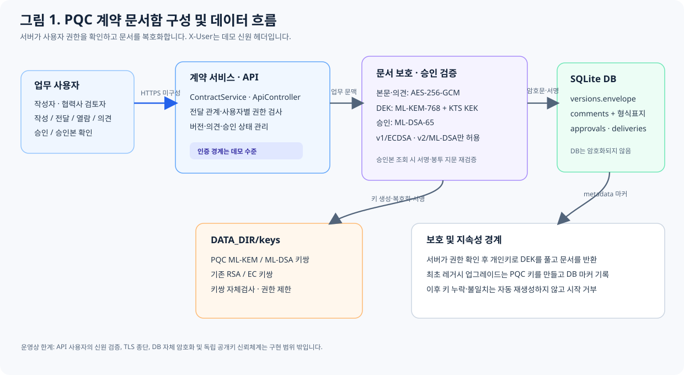
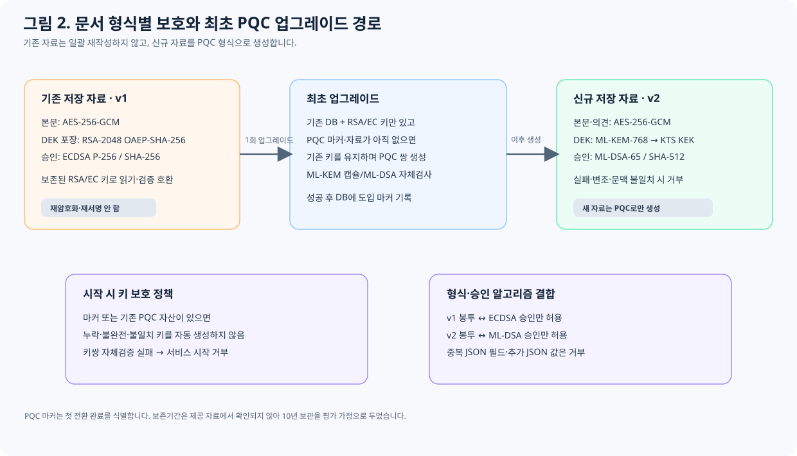

# PQC 해커톤 예선 기술보고서 작성본

## 표지 정보

- 문제: 협력사 계약 문서함의 PQC 전환
- 팀명: 미기재 (개인 참가 시 ‘개인’으로 수정)
- 성명: 미기재
- 버전: `problem_source.zip` 기반 구현 / 2026-11-07

> 이 Markdown은 제출 ZIP과 짝을 이루는 기술 내용 원본입니다. 공식 양식에 옮길 때 표지의 팀·성명 정보를 채우고, 표지 제외 7쪽 이내에 맞춰 그림과 표가 잘리는지 확인해야 합니다. 보고서 본문의 그림은 저장소 `report-assets/` SVG로 포함했습니다.

## 1. 수행 결과 요약

기존 문서함은 문서 본문을 AES-256-GCM으로 암호화하고 데이터 키를 작성자·수신자 RSA-2048 공개키로 각각 RSA-OAEP-SHA-256 포장했으며, 승인은 ECDSA P-256/SHA-256으로 서명했습니다. 새 문서·의견은 작성자와 수신자별 ML-KEM-768 캡슐화로 공유 비밀을 만들고 Bouncy Castle KTS의 KDF로 256-bit AES KEK를 파생해 문서 DEK를 GCM 포장합니다. 본문은 AES-256-GCM으로 보호합니다. 최신 승인에는 ML-DSA-65 서명을 적용하며 계약·버전 문맥 및 봉투 전체의 SHA-512 지문을 서명합니다.

문서 작성·전달·열람·의견·승인·승인본 확인과 사용자별 권한 흐름을 유지했습니다. 기존 저장소에서 과거 RSA/ECDSA 자료는 계속 읽고 확인하되, 새 자료는 PQC 봉투와 서명만 사용합니다. ML-KEM/ML-DSA 처리, AEAD 태그 또는 서명 검증에 실패하면 오류를 반환하는 fail-closed 경로를 적용했습니다. JUnit 테스트 14개와 HTTP API smoke에서 정상 업무 흐름, 레거시 전환, 재시작 후 지속성, 비권한 사용자 거부, 암호문 변경 거부를 확인했습니다. 테스트가 확인하는 `X-User` 헤더는 실습용 신원 선택값일 뿐 인증 수단이 아니므로 실제 배포 권한경계로 간주하면 안 됩니다.

## 2. 수행 목표 및 범위

### 수행 목표

제공 애플리케이션의 기존 API와 사용자별 권한을 유지하면서, 새 계약 자료의 기밀성과 승인 증거의 장기 검증 가능성을 PQC로 보호하는 것이 목표입니다. 요구사항을 구현 목표로 구체화하면 다음과 같습니다.

- 작성·버전 생성·전달·열람·의견 등록·승인·승인본 조회의 정상 흐름을 유지합니다.
- 문서와 의견은 허가된 작성자 및 지정 수신자만 복호화하게 하고, 비권한 열람을 거부합니다.
- 신규 문서의 키 전달과 승인에는 각각 ML-KEM-768과 ML-DSA-65를 사용하고, 저장된 문서 또는 승인 정보가 바뀌면 정상 승인본으로 처리하지 않습니다.
- 기존 DB와 RSA/EC 자산을 가진 환경의 첫 전환을 지원하되, 전환 완료 뒤 PQC 키가 유실·불일치하면 새 키를 자동 생성해 기존 자료를 고립시키지 않습니다.
- 앱 프로세스를 다시 실행해도 전환 후 생성한 문서·의견·승인 정보를 이어서 사용할 수 있게 합니다.

### 수행 범위

실제 변경 범위는 문서 DEK 전달 방식, 신규 승인 서명·검증, 신규 의견 저장 보호, 저장 형식 판별 및 레거시 DB 최초 업그레이드, PQC 키 생성·영속화·무결성 점검, 관련 실패·회귀 시험입니다. 대칭 본문 암호인 AES-256-GCM, SQLite 업무 모델, 기존 업무 API의 경로·역할 흐름은 유지했습니다. 과거 문서 전체의 재암호화·재서명은 하지 않았으며, 기존 RSA-OAEP/ECDSA 데이터는 호환 읽기·검증 경로로 남겼습니다.

제공 소스와 실행 설정에서 외부 사용자 인증, TLS 종단, 독립 공개키 인증, 중앙 KMS/HSM, DB 파일 자체 암호화는 확인되지 않아 구현 범위에 넣지 않았습니다. 따라서 이 작업은 서버 안에서 복호화하는 애플리케이션의 저장·승인 암호 전환이며, 실제 인터넷 배포에 필요한 신원 인증·전송 보호·키 백업 및 독립 검증 인프라까지 완료했다는 의미는 아닙니다. 세부 전환 우선순위와 보존기간 등 확인할 수 없는 운영 조건의 가정은 3절에 구분해 기록했습니다.

## 3. 기존 서비스 구조 및 암호 자산 인벤토리

분석 근거는 `src/main/java/com/partner/contracts/DocumentProtection.java`, `CredentialStore.java`, `ContractService.java`, `ApiController.java`, `Storage.java`, `src/main/resources/schema.sql`, `application.properties`, `compose.yaml` 및 정적 화면의 사용자 선택·API 호출입니다. 흐름은 작성자가 계약을 만들거나 새 버전을 저장하고, 암호화 봉투를 SQLite `versions.envelope`에 기록합니다. 작성자는 특정 검토자에게 버전을 전달하고, 검토자는 전달된 버전을 열람·의견 등록 후 최신 버전을 승인합니다. `approvals`에는 승인자, 시각, 방식, 서명이 남습니다. 본문은 접근 시 서버가 사용자별 개인키로 풀어 API 응답에 돌려줍니다.

| 자산/구성요소 | 소스·저장 근거 | 기존 기능·키 | 민감도/위험 | 전환 상태 |
|---|---|---|---|---|
| 계약 제목·본문·버전 | `versions.title`, `versions.envelope`; `DocumentProtection.protect/open` | AES-256-GCM, 랜덤 256-bit DEK, 기존 RSA-2048 OAEP-SHA-256 DEK 포장. 신규는 ML-KEM-768 공유 비밀→KTS 파생 AES-256 KEK→GCM DEK 포장 | 매우 높음. 계약 조항·기술자료이며 장기 보관·수집 후 복호화 위험 | AES 유지, 공개키 기반 DEK 전달을 ML-KEM-768/KTS로 전환 |
| 계약 의견 | `comments.content`; 원본은 평문 SQLite 저장 | 별도 공개키 암호 없음 | 높음. 의견에 계약 정보·협상 조건이 포함될 수 있음 | 새 의견을 AES-GCM+사용자별 ML-KEM 봉투로 보호 |
| 승인 증거 | `approvals`의 승인자·시각·알고리즘·서명, `ContractService.message` | ECDSA P-256/SHA-256; 계약/버전 문맥과 봉투 SHA-256 지문을 서명 | 매우 높음. 장기 진위·변경 탐지, 장기 검증 필요 | 새 승인 ML-DSA-65 + 봉투 SHA-512 지문 |
| 사용자 공개/개인키 | `CredentialStore`; `DATA_DIR/keys/*.pem`, `.pqc.pem`, `.pqc.pub.pem`; DB `metadata.pqc_keys_initialized`; `/users/{user}/public-keys` | 사용자별 RSA 암호화 키와 EC 서명 키. 공개키는 PEM으로 제공하며 X.509 인증서·CA 체인은 없음 | 최고. 키 유출 시 기밀성 또는 승인 진위 붕괴. 인증된 키 바인딩 부재 | 레거시 키 유지, ML-KEM/ML-DSA 별도 키쌍 생성·영구 보관. 초기 도입 완료 마커와 키쌍 자체검사로 유실·불일치 차단 |
| 업무 DB·전달/권한 메타데이터 | `contracts`, `deliveries`, `comments`, `approvals` SQLite 테이블 | 공개키 암호 없음. 전달 관계와 사용자 ID로 앱 권한 결정 | 높음. 관계·시점·승인 유무의 노출·변조 위험 | DB 자체 암호화는 미적용; 승인 메시지 서명은 승인 문맥과 버전 봉투 지문을 검증 |
| API/전송 계층 | `ApiController`, `application.properties`, `compose.yaml` | `X-User` 헤더 가상 사용자, 소스 내 TLS 미설정 | 인터넷 노출 시 전송·인증 위험 | 프로젝트 내 TLS·인증 전환 없음; 로컬 전용으로 제한 |

### 우선순위와 가정

1. **계약 본문·데이터 키 전달** — 민감도가 가장 높고 이미 저장·전달 봉투에 노출되므로 수집 후 복호화(HNDL)에 우선 대응했습니다. ML-KEM-768 캡슐화는 사용자마다 1,088-byte 암호문을 더하며 공개키는 1,184 bytes입니다(FIPS 203의 원시 인코딩 크기). 각 새 버전에 작성자와 수신자별 캡슐화가 기록됩니다.
2. **승인 서명·검증 키** — 승인본이 장기간 보관되면 ECDSA 위조 가능성은 승인 증거 전체를 약화시킵니다. 신규 승인에 ML-DSA-65를 적용하고 봉투 SHA-512 지문을 포함합니다. FIPS 204 원시 공개키는 1,952 bytes, 서명은 3,309 bytes로 ECDSA보다 커집니다.
3. **의견 본문** — 원본 구현에서 SQLite 평문이 확인되어 새 의견에 동일한 KEM 봉투 보호를 적용했습니다. 인덱싱·검색을 위해 의견 본문 평문을 저장하지 않습니다.
4. **TLS·실제 인증·중앙 키 운영** — 소스·실행 설정에서 TLS, 외부 IdP, KMS/HSM을 찾지 못했습니다. 문서 키를 PQC로 바꾸어도 네트워크 TLS의 양자내성, `X-User` 신뢰성, 서버 탈취 방지까지 해결하지 않습니다. 실제 외부 배포 시 다음 전환 단계로 다뤄야 합니다.

**가정:** 자료에는 보존기간, 법적 보존 의무, 외부 네트워크 경계, TLS 종단, 실제 계정 인증 및 운영 키 백업·복구 절차가 명시되지 않았습니다. 우선순위 산정에서는 계약 종료 뒤 10년까지 본문·승인본을 보관하고, 계약 정보는 그 기간 동안 높은 민감도를 유지하며, 현재 구성은 로컬·신뢰된 단일 서비스로만 쓰인다고 가정했습니다. 실제 기간이 더 짧아도 저장된 봉투의 HNDL 위험과 승인 진위 요구는 남습니다. 반대로 보존기간이 10년을 넘거나 인터넷에 노출되면 TLS/인증·KMS 전환과 감사 로그 우선순위를 더 높여야 합니다.

## 4. 전환 대상과 적용 설계

| 역할 | 적용 알고리즘/방식 | 실패 처리 |
|---|---|---|
| 본문·의견 암호화 | AES-256-GCM, 랜덤 12-byte nonce, 128-bit 태그; 문서 맥락은 AAD | 태그 오류·문맥 불일치 시 내용을 반환하지 않고 409 |
| 사용자별 데이터 키 전달 | ML-KEM-768 (FIPS 203) 단독 PQC KEM. 작성자·수신자 공개키마다 캡슐화하여 공유 비밀과 캡슐화 바이트를 생성. KTSParameterSpec(`AES`, 256)으로 KDF3/SHA-256을 적용해 AES-256 KEK를 파생하고, 이를 랜덤 nonce의 AES-GCM으로 DEK를 포장. 수신자 ID와 버전 문맥을 포장 AAD에 결합 | 알 수 없는 키·캡슐화·인증 오류 시 fail closed. RSA 폴백 없음 |
| 승인·승인본 무결성 | v2 신규 문서에는 ML-DSA-65 (FIPS 204); 도메인 분리된 승인 메시지에 계약/버전 맥락, 승인자/시각, 봉투 SHA-512 지문 포함. v1 레거시에는 기존 ECDSA P-256/SHA-256만 허용 | 봉투 형식과 서명 방식 불일치, 지원하지 않는 형식, 검증 실패, 봉투 변경 시 승인본 거부 |
| 공개키 공개 | PEM 인코딩 공개키를 기존 사용자 공개키 API에서 제공. 용도별 PQC 키 | 불일치·누락 시 키 처리 실패 |

PQC 단독을 택했습니다. 공인된 FIPS 203/204 매개변수의 직접 적용은 하나의 일관된 암호 문맥을 만들고, 하이브리드 키 결합 규칙·클래식 폴백 경로의 구현 오류를 줄입니다. 암호 연산은 서버 내부에서 수행하므로 기존 업무 API 클라이언트에 PQC 연산 구현을 요구하지 않습니다. 다만 외부에서 봉투·서명을 직접 처리하는 검증기는 PQC를 지원해야 하며, 라이브러리 결함 또는 격자 기반 분석 발전에 별도 클래식 방어층이 없습니다. ML-KEM-512보다 보수적인 768을 선택했고, 1024 대비 캡슐 크기·계산량을 낮추는 범주 3 선택입니다. NIST는 FIPS 203 매개변수에서 768을 192-bit 범주로 설명하며 더 높은 보안 세트일수록 성능이 낮아진다고 명시합니다.

**비교 대안:** ML-KEM-768과 X25519를 함께 사용해 독립 비밀을 결합하는 하이브리드 KEM은 전통적 보안과 양자내성을 함께 유지하는 전환기 선택지입니다. 알고리즘 하나의 약화 영향을 낮출 수 있지만, 결합 함수·키 확인·양쪽 실패 처리와 이중 키/캡슐 저장으로 구현·운영 복잡성이 커지고 전송량도 늘어납니다. 이 프로젝트에선 프로토콜·클라이언트 호환 계층이 별도로 없고 새 데이터의 PQC 보호가 필수라 PQC 단독으로 일관되게 전환했습니다. 대안은 설계 비교만 했고 구현·성능 측정은 하지 않았습니다.

## 5. 주요 변경사항과 구현 내용

### 코드·의존성·설정 변경

- `contract-inbox/pom.xml`: `spring-boot-starter-test`와 JUnit 검증을 추가했습니다. PQC 연산은 기존 Bouncy Castle 1.86 Provider/JCA 의존성으로 수행하며 별도 암호 프록시나 네트워크 암호 서비스를 추가하지 않았습니다. 실행 시 `Application`에서 Provider를 등록합니다.
- `Application`·`Storage`: 저장소 초기화 시 `comments.protection_format`이 없는 구형 스키마를 트랜잭션으로 확장하고 기존 의견을 평문 또는 `contract-envelope-v2` 형식으로 분류합니다. 최초 PQC 키 도입 상태는 SQLite `metadata.pqc_keys_initialized`에 기록합니다. DB와 RSA/EC 키만 있고 PQC 봉투·의견·키 자산이 아직 없는 경우에만 PQC 키쌍을 최초 생성합니다. PQC 자료나 초기화 마커가 있으면 누락 키를 자동 생성하지 않고 시작을 거부합니다.
- `CredentialStore`: 사용자별 ML-KEM-768 및 ML-DSA-65 키쌍을 `DATA_DIR/keys`의 기존 레거시 키와 구분되는 PEM 파일로 생성·로드합니다. ML-DSA는 서명/검증, ML-KEM은 캡슐화/역캡슐화 자체검사로 공개키·개인키 짝을 확인합니다. POSIX 시스템에서는 개인키 파일 0600, 키 폴더 0700 권한을 설정합니다.
- `Json`: Jackson 파서에서 중복 필드와 뒤따르는 추가 JSON 토큰을 거부하도록 설정했습니다. 암호 봉투나 승인 레코드에 동일 필드가 중복되어 파서별 해석이 달라지는 경우를 차단합니다.

### 데이터별 처리 절차

| 대상·수정 위치 | 구현 처리 | 호환·실패 동작 |
|---|---|---|
| 신규 계약 본문·버전 (`DocumentProtection`) | 매 버전 랜덤 DEK로 AES-256-GCM 암호화합니다. 작성자와 허가된 수신자 각각에 대해 공개 ML-KEM 키로 캡슐화해 공유 비밀을 만들고, KTS에서 파생한 AES-256 KEK로 DEK를 GCM 포장합니다. 수신자 및 버전 문맥을 AAD에 묶어 `contract-envelope-v2`로 저장합니다. | v1/RSA-OAEP 봉투는 기존 자료 읽기에만 유지합니다. 새 봉투 처리에서 키·캡슐화·태그 검증이 실패하면 복호화를 거부합니다. |
| 신규 의견 (`ContractService`, `comments`) | 의견을 별도 DEK와 AES-GCM으로 암호화하고 작성자·해당 계약 접근자용 KEM 봉투로 보호합니다. 저장 시 `protection_format`을 기록하며 조회 시 먼저 열람 권한을 확인한 뒤 복호화합니다. | 기존 의견은 마이그레이션한 형식 표지로 평문 레거시와 암호 봉투를 구분합니다. 암호화로 표시된 의견이 평문·손상 JSON·미지원 형식으로 바뀌면 409로 거부합니다. |
| 신규 승인·승인본 (`ContractService`) | 최신 버전의 봉투 SHA-512 지문과 계약·버전·승인자·시각 문맥을 포함한 도메인 분리 메시지를 ML-DSA-65 개인키로 서명합니다. 승인본 조회에서 저장 메시지와 봉투 지문을 다시 구성해 공개키로 검증합니다. | v2에는 ML-DSA-65만, v1 레거시에는 ECDSA P-256/SHA-256만 허용합니다. 형식·알고리즘 조합 불일치, 서명 실패, 봉투 변경 시 승인본을 거부합니다. |
| 공개키 제공 및 업무 API (`ApiController`) | 기존 사용자 공개키 API에서 레거시 키와 용도별 PQC 공개키를 PEM으로 제공합니다. 기존 전달·조회·의견·승인 API를 사용하며 암호 처리는 서비스 계층에서 실행합니다. | 사용자 권한 검사를 유지합니다. API의 `X-User`는 현재 실습용 사용자 선택 헤더이며 실제 인증으로 구현된 것은 아닙니다. |

개인키와 DB는 `DATA_DIR`에 영속화되며 제출물에는 포함하지 않습니다. 빈 저장 디렉터리에서는 앱이 DB와 키를 만들고, 저장 영역을 유지해 재시작하면 기존 데이터와 키를 계속 사용합니다. 기존 RSA/EC 키의 재생성은 계속 금지하여 최초 업그레이드가 레거시 신원을 바꾸지 않도록 했습니다. 관련 구현 근거는 `src/main/java/com/partner/contracts/{Application,Storage,CredentialStore,DocumentProtection,ContractService,Json,ApiController}.java`, `src/main/resources/schema.sql`, `pom.xml`입니다.

`PqcWorkflowTest`와 `PqcHardeningTest`는 전체 14개 시험 메서드로 정상 업무, 권한 거부, 레거시 호환, 최초 업그레이드, 키 손실·불일치, 승인 알고리즘 제한, 저장 형식 및 JSON 엄격 파싱을 검사합니다. 각 시험의 관찰 결과와 재현 명령은 7절에 기재했습니다.

기존 DB 전량 재암호화나 재서명은 하지 않았습니다. 기존 RSA/EC 키와 레거시 DB만 있는 최초 업그레이드에서는 기존 키를 그대로 읽고, 누락된 PQC 키쌍만 생성한 뒤 DB에 도입 완료 마커를 씁니다. 이후 재시작에서는 해당 마커가 PQC 키 재생성을 차단합니다. 기존 PQC 봉투·의견·ML-DSA 승인이 있으면 마커가 없더라도 키 생성은 허용하지 않습니다. 개인키·로컬 DB는 프로젝트 ZIP에 넣지 않으며 빈 데이터 디렉터리에서 시작할 때 앱이 키와 DB를 생성합니다.

## 6. 전환 과정의 문제와 해결

전환 과정에서 확인한 문제를 재현 조건, 원인, 선택한 조치 순으로 정리했습니다. 회귀 시험에서 보강 대상 결함을 재현한 뒤 구현을 수정했으며 현재 전체 14개 시험이 통과합니다(7절 참조).

| 발생한 문제·원인 | 검토한 대안과 선택 근거 | 적용 조치·결과 |
|---|---|---|
| 의견 저장 형식이 내용 문자열에서 추론되어 암호화 의견을 평문으로 교체하거나, `{`로 시작하는 정상 레거시 평문을 JSON으로 오인할 수 있었습니다. | 문자열 모양 휴리스틱을 보강하는 대신 저장 형식을 별도 메타데이터로 명시했습니다. 기존 평문 호환과 변조 탐지를 분리하면서 API 응답 스키마를 유지할 수 있습니다. | `comments.protection_format`을 추가하고 이전 의견을 단일 트랜잭션으로 분류했습니다. 신규 의견은 봉투 형식으로 저장하며 암호화로 표시된 레코드가 평문·미지원 형식·손상 JSON이면 409를 반환합니다. `{`로 시작하는 기존 평문은 그대로 조회됩니다. 최초 분류 전에 이미 변조되어 형식 단서가 사라진 자료나 DB 전체의 악의적 재작성을 증명하지는 않습니다. |
| PQC v2 봉투의 승인 레코드에 시험용 레거시 키로 만든 유효한 ECDSA 서명을 넣으면 승인으로 인정되는 조합이 있었습니다. | 모든 형식에서 ECDSA를 거부하면 과거 v1 자료의 확인이 깨집니다. 서명 수학적 유효성뿐 아니라 봉투 버전과 서명 알고리즘의 허용 조합을 검사하도록 했습니다. | v2는 ML-DSA-65, v1은 기존 ECDSA-P256-SHA256만 허용합니다. 회귀 시험 `P-02`에서 v2에 대한 유효 ECDSA 서명이 거부됩니다. |
| 저장 JSON은 중복 필드 또는 첫 객체 뒤의 두 번째 JSON 값이 있어도 파싱될 수 있었습니다. 이는 구성요소마다 암호 형식을 다르게 해석할 여지를 만듭니다. | 개별 필드 사후 비교 대신 공통 Jackson 파서에서 중복 키와 후행 토큰을 거부해 모든 저장 레코드에 일관되게 적용했습니다. | `FAIL_ON_READING_DUP_TREE_KEY`와 `FAIL_ON_TRAILING_TOKENS`를 활성화했습니다. 최상위·중첩 중복 키 및 연속 JSON 입력을 시험에서 거부하며 정상 compact JSON 형식은 유지합니다. |
| 기존 DB의 최초 PQC 업그레이드와 이후 PQC 키 손실을 구분해야 했습니다. DB 존재만으로 생성을 차단하면 최초 도입이 막히고, 매 시작 시 생성하면 기존 자료가 복구 불가능해질 수 있습니다. | DB 유무 단독이 아니라 초기화 마커와 실제 PQC 자산을 함께 검사합니다. 레거시 DB·RSA/EC 키만 있는 경우 최초 생성은 허용하되 PQC 자료 또는 마커가 존재하면 자동 교체를 거부합니다. | `U-01`은 레거시 전용 DB 시작, PQC 키 초기 생성, 신규 업무, 동일 저장소 재기동을 확인합니다. `K-02/K-02b`는 PQC 키 누락·불일치 때 자동 생성 없이 시작이 실패함을 확인합니다. |
| 제품 서비스 외부에서 만든 초기 테스트 서비스에 저장 디렉터리와 BC Provider 설정이 없어 실제 암호 연산 전 테스트 초기화가 실패했습니다. | 제품 부트스트랩을 변경하지 않고 테스트 환경을 실제 실행 조건에 맞췄습니다. | 테스트에서 디렉터리를 먼저 만들고 BC Provider를 등록했습니다. 이후 테스트는 저장·Provider 설정이 적용된 상태로 수행됩니다. |
| 레거시 승인과 신규 PQC 승인의 다이제스트 규칙이 달라 호환 분기에서 기존 증거가 깨질 수 있었습니다. | 과거 승인을 재서명하지 않고 각 형식의 기존 알고리즘·메시지 규칙을 보존하는 호환 처리를 선택했습니다. | v1 ECDSA는 기존 SHA-256 지문, v2 ML-DSA는 봉투 SHA-512 지문을 사용합니다. 형식·알고리즘 불일치는 거부하며 `L-01`, `P-02`로 레거시 호환과 교차 형식 거부를 확인합니다. |

**미해결 사항과 후속 개선:** 승인본 확인은 서버가 저장한 레코드와 서버 관리 공개키의 내부 일관성 검증입니다. 공개키의 독립 인증, 외부 제3자가 검증 가능한 고정 직렬화 증명, 실제 사용자 인증, TLS, 중앙 키 백업·복구는 구현하지 않았습니다. 운영 전에는 독립 공개키 신뢰 배포와 외부 검증 형식, 키 복구 절차를 설계해야 합니다. 최초 DB 분류 이후 DB·형식 표지를 함께 조작하는 공격도 보장 범위 밖입니다. 공식 양식의 팀·성명 정보는 전달받지 않아 임의 기재하지 않았습니다.

## 7. 기능 및 보안 검증

**시험 명령:** Java 21.0.13 Temurin, Maven 3.9.16, Windows 11, Bouncy Castle 1.86에서 `mvn -B test package` 실행. 최종 제출 ZIP을 `pqc-final-hardened` 별도 임시 폴더에 추출해 같은 명령으로 재검증했습니다. 추출본 결과는 `BUILD SUCCESS`, `Tests run: 14, Failures: 0, Errors: 0, Skipped: 0`입니다. HTTP 프로세스 검증은 `pwsh -File scripts/Verify-Http.ps1`로 별도 실행합니다.

| 시험 | 방법 | 관찰 결과 |
|---|---|---|
| 정상 업무·암호 적용 (F-01) | 새 계약 생성 → 전달 → 수신자 본문 열람 → 의견 → 승인 → 작성자 승인본 조회 | 통과. `contract-envelope-v2`, ML-KEM-768, ML-DSA-65 기록 확인. 평문 응답은 권한이 있는 API 요청에서만 복호화되어 제공 |
| 사용자별 접근 | 작성자·수신자 외 `dave`로 문서 읽기, 미전달 수신자 읽기; HTTP 요청은 `X-User: dave` 사용 | 둘 다 서비스 계층에서 거부; HTTP smoke의 비권한 조회 응답은 404 |
| 승인 검증 | 승인본 조회 및 승인 이력 재조회 | 통과. 서명 알고리즘, 승인자, 서명 메시지 검증 경로를 확인 |
| 기존 형식 호환 | 기존 RSA-OAEP/AES-GCM v1 봉투 복호화, 기존 ECDSA-P256/SHA-256 서명 확인 | 통과. 새 ML-DSA 검증 경로에서는 ECDSA 서명이 거부됨 |
| 저장 지속성 | F-01에서 동일 DATA_DIR로 서비스 객체 재생성, U-01에서 Spring Boot 웹 컨텍스트를 종료한 뒤 같은 DATA_DIR로 다시 기동 | 통과. 저장된 문서·승인본은 키 재생성 없이 복호화·검증됨. 재기동 후 승인본 `signature_valid=true`, 본문 동일 |
| 사후 변조 | F-01 테스트에서 승인된 레코드의 암호문 마지막 바이트를 변경한 뒤 승인본 읽기 | 통과. 승인 서명/봉투 지문 검증에서 오류 반환, 정상 승인본으로 취급하지 않음 |
| 저장 키 상태 (K-02/K-02b) | 기존 저장 데이터가 있는 상태에서 ML-KEM 개인키 삭제 또는 공개키 쌍 교체 후 Spring Boot 애플리케이션 컨텍스트로 기동 | 두 경우 모두 컨텍스트 시작이 `InvalidKeyException` 원인으로 실패. 키 파일 자동 재생성 없음 |
| 최초 업그레이드·HTTP 업무 흐름 (U-01) | RSA/EC 키 파일과 기존 형식 DB만 만든 뒤 Spring Boot 웹 컨텍스트 기동; HTTP API로 신규 문서 작성·전달·열람·승인·승인본 조회; 컨텍스트 재기동 후 승인본 재조회 | 통과. 레거시 v1 본문 열람, 신규 ML-KEM 봉투와 ML-DSA 승인, `pqc_keys_initialized` 기록, 재기동 후 `signature_valid=true`와 본문 동일 확인 |
| 최종 JAR의 OS 프로세스 재시작 | 현재 소스에서 패키징한 `target/application.jar`를 별도 DATA_DIR·포트 18083으로 실제 실행; HTTP 문서 생성·전달·승인·승인본 조회 후 프로세스를 종료하고 동일 설정으로 재실행 | 통과. 재기동 후 health=`ok`, 승인 scheme=`ML-DSA-65`, `signature_valid=true`, 본문이 재기동 전과 동일 |
| 제출 ZIP 재현성 | 최종 ZIP을 `pqc-final-hardened`에 추출하고 Java 21/Maven 3.9.16으로 `mvn -B test package` 실행 | 통과. 추출본 `Tests run: 14, Failures: 0, Errors: 0, Skipped: 0`, `BUILD SUCCESS`. 압축기는 29개 항목을 생성했으며 DB·개인키·`target`은 제외했습니다. |
| Docker 신규 환경 실행 | 이번 직접 확인에서 수행하지 않음 | Maven 패키지와 앱 HTTP smoke 및 서비스 계층 테스트까지 확인. Docker daemon을 사용할 수 없어 `docker compose up` 환경 검증은 미수행 |

최종 제출 ZIP을 별도 경로에 추출해 `mvn -B test package`를 실행한 결과는 `Tests run: 14, Failures: 0, Errors: 0, Skipped: 0`, `BUILD SUCCESS`입니다. 추출본의 패키징 JAR도 별도 DATA_DIR로 HTTP 실행해 생성·전달·의견·승인·승인본 흐름, 비권한/미전달 404, 신원 누락 401, 작성자 승인 403, 앱 프로세스 재시작 후 문서·의견·공개키 유지를 확인했습니다. 재현 스크립트는 `scripts/Verify-Http.ps1`입니다. Docker 환경 검증은 포함하지 않았습니다.

추가된 `PqcHardeningTest` 8개는 다음 범위를 확인합니다. `PqcWorkflowTest` 6개와 합쳐 총 14개입니다.

| 시험 | 방법과 결과 |
|---|---|
| H-01 의견 형식 교체 | 암호화 의견을 평문·미지원 format·깨진 JSON으로 교체하면 모두 409. 정상 평문으로 반환하지 않음 |
| H-02 평문 호환 | `{`로 시작하는 기존 평문 의견을 원문대로 조회 |
| H-03 승인 방식 제한 | 시험용 레거시 키로 생성한 수학적으로 유효한 ECDSA 서명도 v2 봉투에서는 409로 거부 |
| H-04 JSON 엄격 검증 | 중복 필드 및 뒤따르는 추가 JSON 값을 거부 |
| H-05 기존 DB 변환 | 이전 6열 comments의 평문/v2 혼재 자료 보존, 반복 시작 시 결과 동일, 내부 형식 열은 API에 노출하지 않음, 변환 후 평문 교체는 재시작 뒤에도 거부 |
| H-06 의견 무결성 | 암호문 비트 변경과 미지원 저장 형식을 409로 거부 |
| H-07 KEM 실패 경로 | KEM ciphertext·wrapped_key·wrap nonce 변경 시 복호화 실패, 원래 자료는 정상 복호화 |
| H-08 키 양쪽 유실 | 초기화 마커를 지워도 PQC 자료가 남아 있으면 공개/개인키 양쪽 유실 시 자동 재생성 없이 시작 실패 |

실제 JAR 프로세스 재시작 검증은 제출 ZIP에 포함된 `scripts/Verify-Http.ps1`로 재현합니다. PowerShell 7에서 실행하며 생성·전달·의견·승인·승인본, 비권한 404, 미전달 404, 신원 누락 401, 작성자 승인 403을 확인합니다. 같은 DATA_DIR로 프로세스를 다시 시작해 본문·의견·공개키가 유지되는지 검사합니다. 상세 시험 안내는 `docs/VERIFICATION.md`, 결과는 `target/http-verification/result.json`에 있습니다.

통합 테스트는 실제 ML-KEM 캡슐화·역캡슐화, ML-DSA 서명·검증을 수행합니다. `PqcWorkflowTest` 6개 메서드는 F-01 `pqcDocumentWorkflowPersistsAndRejectsUnauthorizedOrTamperedAccess`, L-01 `legacyRsaEnvelopeAndEcdsaApprovalRemainReadable`, P-02 `validLegacyEcdsaCannotApprovePqcEnvelope`, U-01 `legacyOnlyDatabaseCanStartAndTransitionToPqc`, K-02 `missingPersistedKeyFailsClosed`, K-02b `mismatchedPersistedKeyPairFailsClosed`입니다. `PqcHardeningTest`의 H-01~H-08은 표의 의견 변조, JSON, DB 마이그레이션, KEM tamper, 양쪽 키 유실을 확인합니다. 상세 로그는 `target/surefire-reports`에 생성됩니다. 직접 확인하지 않은 항목은 성능·메모리 벤치마크, 다중 OS/Docker 신규 환경, 외부 클라이언트 또는 언어 간 상호운용, 공식 FIPS 모듈 검증입니다. Bouncy Castle 일반 JCA Provider는 FIPS 검증 모듈이라고 주장하지 않습니다. TLS 미적용, 외부 인증 미구현, 서버 복호화 구조 때문에 서버 침해·가상 사용자 헤더 위조를 방어하는 종단 간 문서 암호화는 아닙니다.

**검증 범위의 신뢰 한계:** `/approved-copy`에서 서버는 저장된 서명과 서명 메시지를 검증하고 `signature_valid` 결과 및 서버가 관리하는 공개키를 응답합니다. 응답의 `signed_payload`는 JSON 객체이며, 서명 입력은 애플리케이션의 Jackson 직렬화 규칙에 의존합니다. RFC 8785/JCS의 정규 JSON이나 외부 검증용 원시 서명 바이트 프로토콜을 구현한 것은 아닙니다. 공개키도 독립 신뢰기관·핀닝으로 인증되지 않으므로, 현재 결과는 해당 서비스가 가진 승인 기록의 내부 일관성을 확인한 것입니다. 제3자가 서버와 독립해 검증 가능한 증명 형식은 후속 설계 항목입니다.

**요구-구현-검증 연결:**

| 요구·주장 | 구현 근거 | 재현 시험 |
|---|---|---|
| 본문·의견을 수신자별 PQC 보호 | `DocumentProtection.protect/open`, `ContractService.comment/comments` | F-01, L-01 |
| 전달·열람·승인 권한 및 승인본 무결성 | `ContractService.deliver/read/approve`와 `read(..., approvedOnly=true)`, `ApiController` 경로 인가 | F-01 (비권한 404와 암호문 변경 거부) |
| 이전 RSA/ECDSA 데이터 읽기 호환 | `DocumentProtection.open` 및 기존 승인 검증 분기 | L-01 |
| 레거시 DB 최초 PQC 생성 및 그 뒤 키 손실 차단 | Spring `Application.contracts` → `Application.openService`, `Storage.pqcKeysInitialized/hasPqcArtifacts/markPqcKeysInitialized`, `CredentialStore.loadPqc` | U-01, K-02, K-02b |
| 데이터와 승인 키가 프로세스 재시작 후 유지 | `CredentialStore`, SQLite `Storage`; 동일 `DATA_DIR` | F-01 및 HTTP smoke 재시작 |

HTTP smoke는 사용자 요청의 업무 기능과 저장소 재시작을 추가 확인하지만, `X-User` 값 자체가 위조 불가능하다는 점을 증명하지 않습니다. 실제 신원 인증과 공개키 신뢰 배포는 별도 시스템이 필요합니다.

**암호 입력·파생의 재현 정보:**

| 대상 | 실제 구현 규칙 |
|---|---|
| KEM/KTS | `javax.crypto.KEM.getInstance("ML-KEM", "BC")`; Bouncy Castle `KTSParameterSpec.Builder("AES", 256).build()`. BC 1.86 빌더 기본값은 KDF3와 SHA-256, `otherInfo` 빈 바이트열이며 결과 KEK 길이는 256 bit입니다. 별도 KDF 호출이나 XOF 입력은 없습니다. |
| 본문 AAD | `Json.bytes(context)`의 UTF-8 바이트. 문서 context 필드는 `domain`, `contract_id`, `version`, `author`, `recipient`, `title`, `created_at`; Jackson `ORDER_MAP_ENTRIES_BY_KEYS`로 맵 키를 정렬한 기본 compact JSON입니다. |
| 의견 AAD | 같은 직렬화 설정에서 `domain=contract-comment-v1`, `id`, `contract_id`, `version`, `author`, `created_at`를 포함합니다. |
| DEK 포장 AAD | UTF-8 `contract-key-wrap-v2` + 0x00 + UTF-8 수신자 ID + 0x00 + 문서/의견 context 바이트. GCM nonce는 매 포장마다 무작위 12 byte, 태그 128 bit입니다. |
| 승인 서명 입력 | Jackson 정렬 compact JSON의 UTF-8 바이트. 필드는 `domain`, `context`, `envelope_sha512`(레거시는 `envelope_sha256`), `approval_id`, `approver`, `approved_at`, `signature_scheme`; 정렬된 직렬화 키 순서는 알파벳순입니다. JCS/RFC 8785나 외부 고정 바이트 포맷은 아닙니다. |
| 시험 증거 위치 | 테스트 ID와 메서드는 위 목록에 표시. `mvn -B test package` 실행 결과는 `target/surefire-reports/com.partner.contracts.PqcWorkflowTest.txt` 및 `.xml`에 생성됩니다. ZIP에는 빌드 로그/`target`을 싣지 않으며 제출자가 같은 명령으로 재생성합니다. |

**제출 소스 식별:** `contract-inbox-pqc-submission.zip`, SHA-256 `812F6320FA1AAEAC1F8C69F0B8484CE3BD1F1F3D8C58ADCDDB20FD826383C1C7` (29개 항목). 이 값은 최종 ZIP을 재현 빌드한 뒤 계산했습니다.

## AI 활용 여부 및 사용 프롬프트

OpenAI Codex 데스크톱에서 GPT-6 계열 모델을 사용했습니다. 현재 실행 화면은 더 세부적인 모델 빌드·버전 식별자를 제공하지 않아 이를 확인된 값처럼 기재하지 않았습니다. 다음은 실제 수행 질문의 요지이며, 축약·정리한 문장입니다.

| 주요 프롬프트(요지) | AI 답변 요약 | 사용 여부 및 판단 |
|---|---|---|
| 제공 소스의 데이터 흐름·암호 자산·위험·전환 우선순위를 분석해 달라 | 계약 봉투, 승인 기록, 의견, 키 저장소 및 전송/인증 경계를 인벤토리화하고 장기 기밀성과 승인 진위를 우선 전환 대상으로 제안 | 사용. 각 항목을 소스·스키마·설정과 대조해 보고서에 반영 |
| 기존 계약 업무 흐름을 유지하면서 PQC KEM과 서명을 적용해 달라 | ML-KEM-768/KTS 기반 DEK 보호, ML-DSA-65 승인, 레거시 읽기 호환 설계를 제안 | 사용. 구현 코드와 실제 알고리즘 연산 시험으로 채택 범위를 확인 |
| 권한, 변조, 키 유실, 재시작을 재현 가능한 시험으로 확인해 달라 | 정상 흐름, 실패 경로, 기존 저장소 업그레이드, 키쌍 검사 및 재시작 시험을 제안 | 사용. 통과한 시험만 완료 결과로 보고. 성능·Docker·외부 상호운용은 미검증으로 남김 |
| 보안 검토에서 발견한 ECDSA 승인 혼합과 중복 JSON 필드를 수정해 달라 | v1/ECDSA·v2/ML-DSA 허용 조합, 엄격 중복·trailing token 파싱, 공격 재현 시험을 제안 | 사용. `P-02`, `H-04` 회귀 시험과 코드에서 동작 확인 |
| 기술보고서 항목 파일에 맞춰 제출 내용을 보완해 달라 | 그림, 범위·인벤토리·설계·구현·문제·검증·AI 활용을 빠짐없이 구성하도록 제안 | 사용. 이 문서에 구성도·전환도를 삽입하고 불일치한 시험 수와 설명을 소스에 맞춰 정정 |

검토한 하이브리드 ML-KEM/X25519 설계는 구현하지 않았습니다. 대상 API 클라이언트의 프로토콜 호환 계층이 없고, 서버 내부 암호 서비스로 신규 문서의 PQC 보호를 완료할 수 있어 단독 PQC를 선택했습니다. AI가 제안한 내용은 구현·검증을 거친 범위에서만 사실로 기술했습니다.

## 참고자료

1. NIST, [FIPS 203: Module-Lattice-Based Key-Encapsulation Mechanism Standard](https://csrc.nist.gov/pubs/fips/203/final), 2024-08-13. 정오표/수정 공지 포함.
2. NIST, [FIPS 204: Module-Lattice-Based Digital Signature Standard](https://csrc.nist.gov/pubs/fips/204/final), 2024-08-13.
3. NIST, [SP 800-227: Recommendations for Key-Encapsulation Mechanisms](https://csrc.nist.gov/pubs/sp/800/227/final).
4. Bouncy Castle, [Java 1.86 release](https://www.bouncycastle.org/resources/new-release-bouncy-castle-java-1-86/), [PQC Almanac — Java examples](https://downloads.bouncycastle.org/java/docs/PQC-Almanac.pdf).
5. Oracle, [Java SE 21 KEM API](https://docs.oracle.com/en/java/javase/21/docs/api/java.base/javax/crypto/KEM.html).
