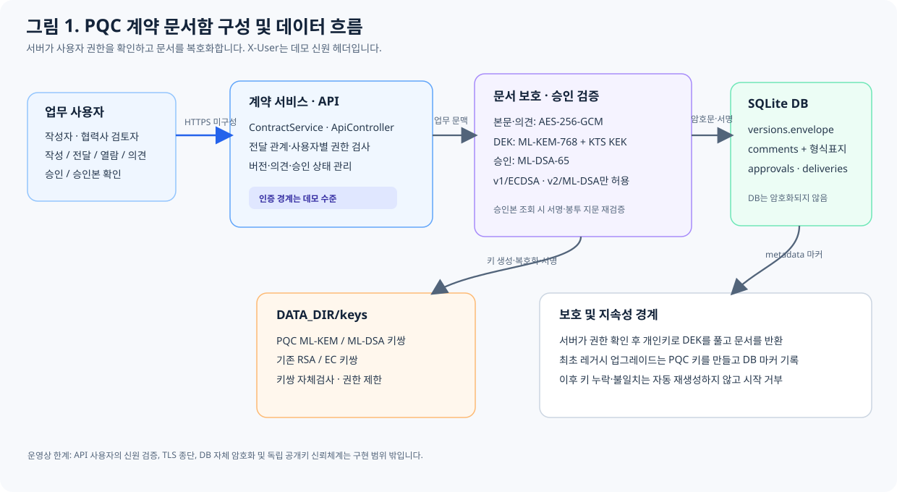
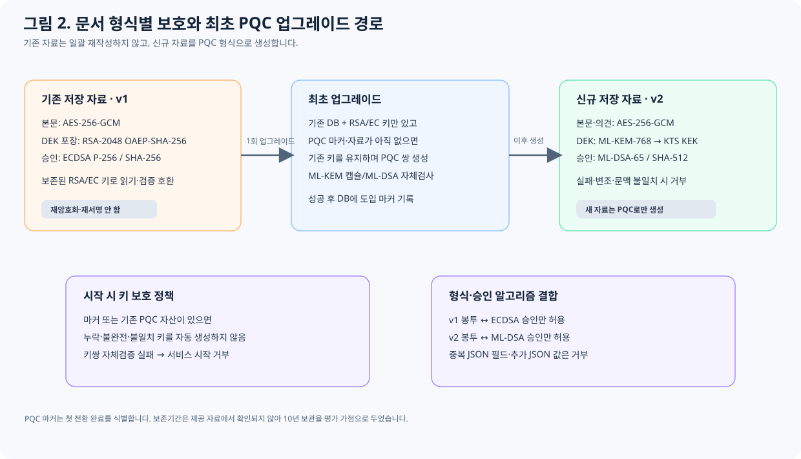

# PQC 해커톤 예선 기술보고서

## 표지 정보

- 문제: 협력사 계약 문서함의 PQC 전환
- 팀명: 미기재(개인 참가 시 ‘개인’으로 변경)
- 성명: 미기재
- 제출 소스: `contract-inbox-pqc-submission.zip` (SHA-256: `812F6320FA1AAEAC1F8C69F0B8484CE3BD1F1F3D8C58ADCDDB20FD826383C1C7`)

> 이 Markdown은 제공된 기술보고서 작성 항목을 반영한 내용 원고이다. 제출 전 공식 양식으로 옮기면서 팀·성명을 기입하고, 제공 양식의 기본 서식을 유지한 상태로 표지 제외 7쪽 이내인지 확인해야 한다. 페이지 수는 공식 양식에서 최종 확인한다.

## 1. 수행 결과 요약

협력사 계약 문서함의 신규 문서 키 전달을 RSA-OAEP에서 ML-KEM-768로, 신규 승인 서명을 ECDSA P-256에서 ML-DSA-65로 전환했다. 문서와 의견 본문은 AES-256-GCM을 유지하되, DEK를 수신자별 KEM 공유 비밀에서 파생한 AES-256 KEK로 포장한다. 기존 RSA/ECDSA 문서는 읽기·검증 호환 경로로 남겼다.

기존 API의 작성·전달·열람·의견·승인·승인본 확인 흐름을 유지했다. 사용자별 권한 확인, 암호문 무결성 검사, 문서 형식과 승인 알고리즘의 조합 검사, PQC 키 누락 시 자동 재생성 금지를 구현했다. Java 21 및 Maven 환경에서 JUnit 14개가 통과하고 패키징이 성공했다. 별도 HTTP 검증에서는 업무 흐름과 프로세스 재시작 후 데이터 지속성을 확인했다. 실제 사용자 인증, TLS, 제3자 독립 서명검증, 성능 측정 및 Docker 실행은 구현 또는 검증 범위에 포함되지 않는다.

## 2. 수행 목표 및 범위

수행 목표는 계약 본문과 승인 증거를 장기간 보관하는 서비스에 PQC를 적용하면서 기존 업무 API와 접근권한을 보존하는 것이다. 새로 생성하는 문서와 의견은 허가된 작성자·지정 수신자만 복호화할 수 있어야 하며, 변경된 암호문이나 형식에 맞지 않는 서명은 정상 승인본으로 인정하지 않아야 한다. 또한 저장 영역을 유지한 서비스 재시작 후에도 문서와 승인 정보를 사용할 수 있어야 한다.

구현 범위는 신규 문서의 DEK 전달, 신규 승인 서명·검증, 신규 의견의 암호화, 의견 형식 마이그레이션, 레거시 DB의 최초 PQC 키 도입, 키쌍 자체검사와 실패 처리이다. 대칭 암호 AES-256-GCM, SQLite 업무 모델, 기존 API 경로와 전달·권한 흐름은 유지했다. 과거 자료 전체의 재암호화·재서명은 요구되지 않아 수행하지 않았다.

소스와 실행 설정에서 TLS 종단, 외부 사용자 인증, 독립 공개키 인증, KMS/HSM, DB 자체 암호화는 확인하지 못했다. 따라서 본 구현은 서버 측 저장 암호 및 승인 검증 전환으로 한정된다. 실제 외부 배포 환경에서 필요한 TLS, 인증, 키 백업·복구, 독립 신뢰 공개키 배포는 별도 과제로 남긴다.

## 3. 기존 서비스 구조 및 암호 사용 현황

분석 근거는 `DocumentProtection.java`, `CredentialStore.java`, `ContractService.java`, `ApiController.java`, `Storage.java`, `schema.sql`, `application.properties`, `compose.yaml` 및 화면의 API 호출이다. 작성자가 계약을 생성하면 암호화된 버전 봉투가 SQLite `versions.envelope`에 기록된다. 작성자는 검토자에게 버전을 전달하고, 지정 수신자는 전달된 문서를 열람해 의견을 등록한 뒤 최신 버전을 승인한다. 승인자·시각·알고리즘·서명은 `approvals`에 기록된다. 열람 시 서버가 사용자 개인키로 DEK를 복구하고 본문을 복호화해 API로 반환한다.

| 자산 | 기존 보호 및 근거 | 민감도·위험 | 전환 결과 |
|---|---|---|---|
| 계약 제목·본문·버전 (`versions`) | AES-256-GCM, 랜덤 256-bit DEK, RSA-2048 OAEP-SHA-256으로 DEK 포장 | 매우 높음. 장기 보관 시 수집 후 복호화 위험 | AES 유지, DEK 전달을 ML-KEM-768/KTS로 전환 |
| 의견 (`comments`) | 기존 평문 SQLite 저장 | 높음. 협상 내용 및 계약 정보 노출 가능 | 신규 의견 AES-GCM 및 사용자별 KEM 봉투 적용 |
| 승인 증거 (`approvals`) | ECDSA P-256/SHA-256. 승인 문맥 및 봉투 SHA-256 지문 포함 | 매우 높음. 서명 위조 시 승인 진위 훼손 | 신규 승인에 ML-DSA-65와 봉투 SHA-512 지문 적용 |
| 암호 키 (`DATA_DIR/keys`, `CredentialStore`) | 사용자별 RSA 암호화 키와 EC 서명 키 | 최고. 키 손실·유출이 문서 기밀성 또는 승인 진위에 영향 | 레거시 키 유지, ML-KEM/ML-DSA 키쌍 추가 및 유실 차단 |
| DB·전달·권한 메타데이터 | SQLite `contracts`, `deliveries`, `comments`, `approvals`; 사용자 ID와 전달 관계로 권한 결정 | 높음. 관계 및 승인 상태 노출·변조 위험 | DB 자체 암호화는 미적용; 서비스 권한검사와 서명 문맥 검증 유지 |
| API·전송 | `X-User` 실습용 사용자 선택, 소스 내 TLS 미설정 | 외부 노출 시 인증·전송 위험 | 현 구현은 로컬 실습 범위로 제한, 운영 전 인증·TLS 필요 |

전환 우선순위는 계약 본문·DEK 전달, 승인 서명·검증 키, 의견 순으로 두었다. 본문은 민감도가 높고 저장된 암호문이 장기간 노출될 수 있어 수집 후 복호화(HNDL) 위험에 우선 대응했다. 승인은 계약의 승인 사실을 장기 입증하므로 신규 서명을 PQC화했다. 의견은 기존 구현에서 평문 저장이 확인되어 새 기록부터 암호화했다. TLS·실제 인증·중앙 키 관리는 저장 암호 전환만으로 해결되지 않는 운영 경계로 식별했다.

자료에는 보존기간, 외부 네트워크 경계, 실 사용자 인증, 키 백업·복구 조건이 없다. 우선순위 산정에서는 계약 종료 후 10년 보관, 그 기간 동안 높은 민감도 유지, 로컬·신뢰된 단일 서비스 사용을 가정했다. 보존기간이 더 길거나 서비스가 인터넷에 노출된다면 TLS·인증 및 키 운영 전환의 우선순위를 높여야 한다. 10년은 제공 자료에서 확인한 사실이 아니라 판단을 위한 가정이다.

## 4. 전환 대상과 적용 설계

신규 문서와 의견은 AES-256-GCM으로 암호화한다. 각 문맥에서 랜덤 DEK를 생성하고, 작성자 및 지정 수신자의 ML-KEM-768 공개키 각각에 캡슐화하여 공유 비밀과 캡슐화 메시지를 만든다. Bouncy Castle KTS(`KTSParameterSpec.Builder("AES", 256)`)에서 KDF3/SHA-256으로 AES-256 KEK를 파생하고 AES-GCM으로 DEK를 포장한다. 수신자 ID와 문서 문맥을 AAD에 결합한다. 승인 메시지는 도메인 분리와 계약·버전·승인자·시각·봉투 SHA-512 지문을 포함해 ML-DSA-65로 서명한다.

PQC 단독을 선택해 신규 문서 데이터 경로의 암호 문맥을 단순하게 유지하고, 하이브리드 결합·클래식 폴백의 구현 오류 가능성을 줄였다. 단점은 ML-KEM 또는 ML-DSA 구현이나 선택 매개변수에서 취약점이 발견될 경우 별도의 고전 알고리즘 방어층이 없다는 것이다. 대안인 ML-KEM-768/X25519 하이브리드는 양쪽 알고리즘의 독립 비밀을 결합해 전환기 방어층을 제공할 수 있지만, 결합 규칙, 키 확인, 실패 처리, 이중 키·캡슐 저장을 추가해 프로토콜과 운영이 복잡해진다. 이 대안은 설계 비교만 수행했으며 구현·성능은 검증하지 않았다.

FIPS 203 ML-KEM-768과 FIPS 204 ML-DSA-65를 선택했다. 구현된 Bouncy Castle 일반 Provider는 FIPS 검증 모듈이 아니다. 알고리즘 명칭의 표준 적합성과 모듈 인증은 별개의 주장으로 취급한다. KEM/서명 크기 증가와 성능 영향은 문헌 및 표준 매개변수 크기에 근거한 설계 판단이며, 본 프로젝트에서 처리량·지연·메모리를 실측하지 않았다.

## 5. 주요 변경사항과 구현 내용

PQC 연산은 Bouncy Castle 1.86 JCA Provider로 수행하며 별도 프록시나 암호 서비스를 추가하지 않았다. `pom.xml`에 `spring-boot-starter-test`를 추가했다. `Application`과 `Storage`는 DB 초기화 시 `comments.protection_format` 열이 없으면 트랜잭션으로 추가하고 기존 의견을 평문 또는 `contract-envelope-v2`로 분류한다. 최초 PQC 키 도입 상태는 SQLite `metadata.pqc_keys_initialized`에 기록한다. 레거시 DB와 RSA/EC 키만 존재하고 PQC 자료가 없을 때에는 최초 PQC 키 생성을 허용하지만, 마커 또는 PQC 자료가 이미 있는데 키가 누락된 경우에는 자동 생성하지 않고 시작을 거부한다.

`CredentialStore`는 사용자별 ML-KEM-768 및 ML-DSA-65 키쌍을 `DATA_DIR/keys`에 PEM 형식으로 저장한다. ML-DSA 키쌍은 서명·검증, ML-KEM 키쌍은 캡슐화·역캡슐화 자체검사로 대응 여부를 확인한다. POSIX에서는 개인키 파일 0600, 키 폴더 0700을 설정한다. 저장 디렉터리와 키는 제출 ZIP에 포함하지 않으며, 새로운 환경에서 애플리케이션이 생성한다.

`DocumentProtection`은 새 본문과 의견에 `contract-envelope-v2`를 생성한다. 본문과 의견은 AES-256-GCM으로 보호하고 DEK는 수신자별 ML-KEM 캡슐화에서 파생한 KEK로 포장한다. 기존 v1/RSA 봉투는 레거시 자료를 읽는 데만 사용한다. `ContractService`는 신규 v2 승인에 ML-DSA-65, 기존 v1 승인에 ECDSA-P256-SHA256만 허용하며, 버전과 서명 방식의 불일치를 거부한다. 의견은 `protection_format`을 함께 저장하고 권한 확인 후 복호화한다. 암호화 형식으로 표시된 자료의 평문 교체, 손상 JSON 및 미지원 형식은 오류로 거부한다.

`Json`은 Jackson의 중복 필드 감지와 후행 토큰 거부를 활성화했다. 공개키는 기존 사용자 공개키 API에서 PEM으로 제공한다. 기존 API 권한 흐름을 유지하지만 `X-User` 헤더는 인증이 아니라 실습용 사용자 선택값이다. 주요 변경 근거는 `src/main/java/com/partner/contracts/`의 `Application`, `Storage`, `CredentialStore`, `DocumentProtection`, `ContractService`, `Json`, `ApiController`와 `src/main/resources/schema.sql`, `pom.xml`이다.

## 6. 전환 과정에서의 문제와 해결

전환 중 암호화 의견을 평문으로 바꿔도 반환될 수 있었고, `{`로 시작하는 기존 평문 의견을 JSON으로 오인할 수 있음을 확인했다. 문자열 모양을 기준으로 형식을 추정하는 방식은 변형 사례마다 예외처리가 필요하므로 충분하지 않다고 판단했다. 이에 `comments.protection_format`을 도입해 저장 형식을 명시하고 기존 의견을 트랜잭션으로 분류했다. 이후 암호화 의견이 평문·손상 JSON·미지원 형식으로 바뀌면 409로 거부한다. 기존 평문 의견은 원문 그대로 조회한다. 다만 마이그레이션 이전에 변조되어 형식 단서가 이미 사라진 레코드와 DB 전체가 함께 조작된 상황은 판별할 수 없다.

PQC v2 봉투에 시험용 레거시 개인키로 생성한 유효한 ECDSA 서명을 연결했을 때 승인으로 인정되는 결함을 재현했다. 모든 ECDSA를 차단하면 기존 v1 승인의 검증이 중단되므로, 서명의 수학적 유효성 외에 문서 형식과 허용 알고리즘의 조합을 검사하도록 수정했다. v2에는 ML-DSA-65, v1에는 ECDSA-P256-SHA256만 허용하며 `P-02` 시험에서 v2에 대한 유효 ECDSA 서명의 거부를 확인했다.

저장 JSON에서 중복 필드와 첫 객체 뒤의 추가 JSON 값이 허용되는 문제도 확인했다. 개별 필드를 사후 검사하는 대신 공통 Jackson 파서에서 중복 키와 후행 토큰을 거부하도록 하였다. 그 결과 최상위·중첩 중복 필드 및 연속 JSON 입력이 거부되고 정상 JSON 형식은 유지된다.

기존 DB의 최초 PQC 전환과 전환 후 PQC 키 유실은 서로 다른 처리 조건이 필요했다. DB 존재만으로 키 생성을 막으면 레거시 저장소의 최초 업그레이드가 불가능하고, 매번 키를 생성하면 기존 PQC 자료를 복구할 수 없기 때문이다. 초기화 마커와 PQC 자료 존재 여부를 함께 검사하도록 구현했다. `U-01`은 레거시 전용 DB의 최초 기동, PQC 키 생성, 신규 업무 처리와 재기동을 확인하고, `K-02/K-02b`는 키 누락·불일치 때 자동 생성 없이 시작이 실패하는지 확인한다.

초기 테스트에서는 테스트 서비스가 저장 디렉터리를 만들지 않았고 Bouncy Castle Provider도 등록되지 않아 암호 연산 전 초기화가 실패했다. 제품 부트스트랩을 변경하는 대신 테스트 초기화에서 디렉터리 생성과 Provider 등록을 수행하도록 조정했다. 또한 레거시 ECDSA와 신규 ML-DSA 승인 메시지는 지문 규칙이 다르므로 과거 자료를 재서명하지 않고 v1의 SHA-256, v2의 SHA-512 규칙을 유지했다. 형식과 알고리즘의 불일치는 거부하며 레거시 호환과 교차 형식 거부는 `L-01`, `P-02`로 확인했다.

미해결 사항은 공개키의 독립 인증, 제3자 검증이 가능한 고정 직렬화 서명 형식, 실제 사용자 인증, TLS, 중앙 키 백업·복구이다. 승인본 검증은 현재 서버 저장 레코드와 서버 관리 공개키 사이의 내부 일관성 확인이며 독립적인 제3자 증명은 아니다. 운영 전에는 신뢰 가능한 공개키 배포, 키 복구 절차와 외부 검증 형식을 추가로 설계해야 한다.

## 7. 기능 및 보안 검증

검증 환경은 Windows 11, Temurin Java 21.0.13, Maven 3.9.16, Bouncy Castle 1.86이다. `mvn -B test package`로 JUnit 테스트와 패키징을 수행했다. 결과는 `PqcWorkflowTest` 6개 및 `PqcHardeningTest` 8개, 총 14개 테스트 통과이며 실패·오류·건너뜀은 없고 Maven 빌드는 `BUILD SUCCESS`였다.

| 시험 ID/방법 | 결과 |
|---|---|
| F-01: 신규 계약 생성, 전달, 수신자 열람, 의견, 승인 및 승인본 조회 | 통과. v2 봉투, ML-KEM-768, ML-DSA-65 사용 확인 |
| 권한: 미전달 사용자 및 비권한 사용자 조회 | 통과. 서비스에서 거부되고 HTTP smoke에서 404 반환 |
| L-01: 기존 RSA-OAEP/AES-GCM v1 봉투와 ECDSA 승인 조회 | 통과. 레거시 경로 유지 확인 |
| P-02: 유효 ECDSA 서명을 PQC v2 승인에 삽입 | 통과. 형식·알고리즘 불일치로 거부 |
| H-01~H-08: 의견 형식 변조, 중복 JSON, DB 마이그레이션, KEM 변조, 양쪽 키 유실 | 통과. 손상·미지원 입력 거부 확인 |
| U-01: 레거시 DB 최초 전환 및 동일 저장소 재기동 | 통과. 신규 PQC 문서·승인 생성과 재기동 후 검증 확인 |
| K-02/K-02b: 저장 PQC 키 삭제·불일치 후 앱 시작 | 통과. 키 자동 재생성 없이 시작 실패 |
| 최종 JAR HTTP 프로세스 재시작 | 통과. 같은 DATA_DIR로 재기동 후 본문·의견·공개키·승인 검증 지속 확인 |

HTTP 검증은 PowerShell 7에서 `pwsh -File scripts/Verify-Http.ps1`로 실행할 수 있다. 동일 데이터 디렉터리로 프로세스를 재시작해 health 응답, 승인 서명 유효성 및 문서 지속성을 확인한다. 시험 로그는 `target/surefire-reports`에 생성되며, 제출 ZIP에는 빌드 산출물과 업무 DB·개인키를 포함하지 않는다. Docker 신규 환경, 다중 OS, 성능·메모리 벤치마크, 외부 클라이언트 상호운용 및 공식 FIPS 모듈 인증은 검증하지 않았다. 사용자 인증이 `X-User` 헤더에 의존하고 서버가 복호화를 수행하므로, 서버 침해와 헤더 위조에 대한 종단간 기밀성을 보장하지 않는다.

## AI 활용 여부

OpenAI Codex 데스크톱을 사용했다. 실행 화면에서 세부 모델 빌드·버전 식별자를 확인할 수 없어 이를 확인된 값으로 기재하지 않았다. 아래 프롬프트는 실제 질문의 요지를 축약한 것이다.

| 주요 질문(요지) | 답변 활용 및 판단 |
|---|---|
| 기존 소스의 데이터 흐름, 암호 자산, 위험과 전환 우선순위를 분석해 달라 | 인벤토리와 장기 기밀성 위험 분석을 참고하고 소스·스키마·설정과 대조해 반영했다. |
| 업무 흐름을 유지하면서 PQC KEM 및 서명을 적용해 달라 | ML-KEM-768/KTS와 ML-DSA-65 설계를 참고했으며, 구현 및 알고리즘 연산 시험으로 적용 범위를 확인했다. |
| 권한, 변조, 키 유실, 재시작을 검증해 달라 | 시험 시나리오 구성을 참고하고 실제 통과한 결과만 보고서에 기재했다. |
| 유효한 레거시 ECDSA 승인과 중복 JSON 문제를 수정해 달라 | 형식·서명 조합 제한, 엄격 JSON 파싱 및 회귀시험을 반영하고 `P-02`, `H-04`로 확인했다. |
| 보고서 항목에 따라 제출 내용을 정리해 달라 | 보고서 구성과 누락 항목 확인에 활용하고 소스 및 시험 결과에 맞게 내용을 수정했다. |

AI 답변은 초안과 분석 보조로 사용했으며, 설계·구현·시험 사실은 제출 소스와 직접 실행한 결과를 기준으로 판단했다. 하이브리드 ML-KEM/X25519는 검토 대안으로만 기술했으며 구현 완료 사항으로 보고하지 않았다.

## 참고자료

1. NIST, [FIPS 203: Module-Lattice-Based Key-Encapsulation Mechanism Standard](https://csrc.nist.gov/pubs/fips/203/final), 2024.
2. NIST, [FIPS 204: Module-Lattice-Based Digital Signature Standard](https://csrc.nist.gov/pubs/fips/204/final), 2024.
3. NIST, [SP 800-227: Recommendations for Key-Encapsulation Mechanisms](https://csrc.nist.gov/pubs/sp/800/227/final).
4. Bouncy Castle, [Java 1.86 release](https://www.bouncycastle.org/resources/new-release-bouncy-castle-java-1-86/) 및 [PQC Almanac](https://downloads.bouncycastle.org/java/docs/PQC-Almanac.pdf).
5. Oracle, [Java SE 21 KEM API](https://docs.oracle.com/en/java/javase/21/docs/api/java.base/javax/crypto/KEM.html).
